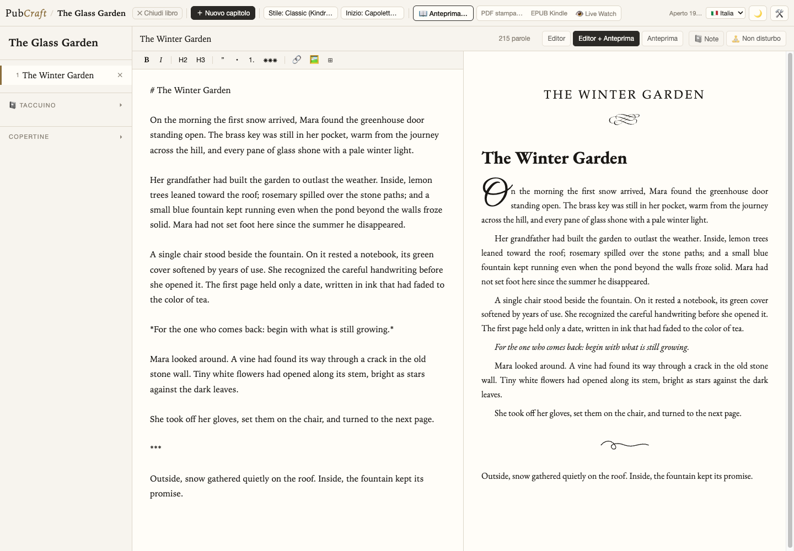

# PubCraft

**Scrivi il tuo libro in Markdown. Conserva i file sul tuo computer. Esporta EPUB e impaginati di stampa dallo stesso progetto.**

PubCraft è uno strumento gratuito e open source per scrivere e pubblicare libri: editor locale nel browser, compilatore CLI in C, importazione di manoscritti, esportazione EPUB e anteprime di stampa. Il progetto rimane composto da normali file Markdown e `book.yaml`.

> **Software alfa:** conserva backup e lavora su copie dei tuoi manoscritti. Controlla ogni importazione/esportazione. Un file generato non è automaticamente certificato per Amazon KDP, IngramSpark o altri distributori.

[](https://github.com/massigent/PubCraft/actions/workflows/ci.yml)
[](LICENSE)

**Ultima versione: 1.0.0-alpha.2** — [Note di rilascio e tutti i download](https://github.com/massigent/PubCraft/releases/tag/v1.0.0-alpha.2)

| Sistema | Download |
| --- | --- |
| Windows x64 | [Installer](https://github.com/massigent/PubCraft/releases/download/v1.0.0-alpha.2/PubCraft-Setup-1.0.0-alpha.2.exe) · [ZIP portatile](https://github.com/massigent/PubCraft/releases/download/v1.0.0-alpha.2/PubCraft-1.0.0-alpha.2-windows-x64.zip) |
| macOS Intel | [App DMG](https://github.com/massigent/PubCraft/releases/download/v1.0.0-alpha.2/PubCraft-1.0.0-alpha.2.dmg) · [Installer PKG](https://github.com/massigent/PubCraft/releases/download/v1.0.0-alpha.2/PubCraft-1.0.0-alpha.2.pkg) · [Archivio portatile](https://github.com/massigent/PubCraft/releases/download/v1.0.0-alpha.2/PubCraft-1.0.0-alpha.2-macos.tar.gz) |
| Linux x64 | [AppImage](https://github.com/massigent/PubCraft/releases/download/v1.0.0-alpha.2/PubCraft-1.0.0-alpha.2-x86_64.AppImage) · [Debian/Ubuntu](https://github.com/massigent/PubCraft/releases/download/v1.0.0-alpha.2/PubCraft-1.0.0-alpha.2-linux-amd64.deb) · [Archivio portatile](https://github.com/massigent/PubCraft/releases/download/v1.0.0-alpha.2/PubCraft-1.0.0-alpha.2-linux-x64.tar.gz) |

[Checksum SHA-256](https://github.com/massigent/PubCraft/releases/download/v1.0.0-alpha.2/checksums-sha256.txt) · [English](README.md) · [Segnala un problema](https://github.com/massigent/PubCraft/issues/new?template=bug_report.md) · [Contribuisci](CONTRIBUTING.md)

**Prima di aggiornare:** chiudi la vecchia applicazione. Su Apple Silicon questa build Intel richiede Rosetta. L'app macOS ha una firma ad-hoc, non una firma Developer ID o notarizzazione Apple; PKG macOS e installer Windows non sono firmati da un editore verificato. Il sistema può mostrare avvisi di sicurezza. Usa la Release ufficiale e verifica i checksum. Gli archivi GitHub “Source code” contengono sorgenti, non programmi pronti da avviare.



## Novità della seconda alfa

- **Organizzazione:** vista Corkboard a schede, sinossi, stato dei capitoli, conteggi di parole per selezione/sessione, palette comandi e menu riorganizzati.
- **Import Scrivener:** progetti, Binder, RTF supportato, template e archivi ZIP; miglioramenti a DOCX, ODT e Markdown.
- **Protezione dei progetti:** selezione/importazione non distruttive, YAML invalido preservato, salvataggi versionati, blocchi fra schede/progetti, copertine e cestino senza perdita dei contenuti precedenti.
- **EPUB:** sanitizzazione XML/UTF-8, immagini annidate, manifest coerenti, liste valide e identificatori persistenti.
- **Anteprime e diagnostica:** revisioni più affidabili, aggiornamenti UUID sicuri, configurazione isolata e coordinamento MCP/GUI.

Tutti i dettagli sono nelle [note di rilascio bilingui](RELEASE_NOTES_1.0.0-alpha.2.md), nel [changelog](CHANGELOG.md) e nel [resoconto di validazione](docs/RELEASE_VALIDATION_1.0.0-alpha.2.md).

## Perché PubCraft?

- **File portabili:** capitoli Markdown, metadati YAML e immagini locali, modificabili anche con altri editor.
- **Lavoro locale:** nessun account o backend cloud PubCraft. Eventuali servizi AI esterni collegati tramite MCP hanno le proprie politiche di riservatezza.
- **Importazione:** Vellum, Scrivener, DOCX, ODT, Markdown e PDF. La conversione non riproduce perfettamente ogni caratteristica del documento originale: verifica il risultato.
- **Scrittura e pubblicazione:** capitoli, note, anteprima del manoscritto, controlli tipografici e anteprime reali EPUB/PDF generate su richiesta.
- **Stampa:** HTML/PDF con impostazioni di formato e abbondanza. Il PDF richiede un renderer supportato disponibile; resa e paginazione possono variare.
- **Gratuito e open source:** codice MIT; font e dipendenze mantengono le rispettive licenze.

## Iniziare

Avvia l'applicazione e scegli **Nuovo libro** oppure una cartella progetto. Il progetto contiene `book.yaml`, capitoli `.md`/`.markdown` e, facoltativamente, `cover/` e `images/`. Conserva l'originale e un backup separato.

### Interfaccia e Watch

```sh
pubcraftgui ./mio-libro
pubcraftgui --watch ./mio-libro
```

L'interfaccia usa il browser, ma viene servita da un processo locale: non è un servizio web ospitato. Il binario GUI include anche l'ingresso MCP su stdio, `pubcraftgui --mcp`.

### CLI

```sh
pubcraft init ./mio-libro "Il mio libro"
pubcraft build ./mio-libro ./mio-libro.epub --kindle
pubcraft build-print ./mio-libro ./out-stampa --trim 6x9 --pages 200 --pdf
```

### Conversione Vellum

```sh
pubcraft export-md "./Il mio libro.vellum" "./Il mio libro-markdown"
```

Apri la cartella convertita in PubCraft o in un altro editor Markdown. Verifica ordine, immagini e formattazione. Gli altri formati supportati sono importabili dalla GUI.

## Compilazione e test

Requisiti: `make`, compilatore C e Go 1.23+. I test browser opzionali richiedono Node.js e una sessione Chromium/Brave dedicata con debugging remoto.

```sh
make
make check
go -C src/pubcraftgui test -race -count=1 ./...
```

`-count=1` evita risultati Go in cache quando cambia soltanto il binario C esterno. Consulta [tests/README.md](tests/README.md) e il [resoconto di validazione](docs/RELEASE_VALIDATION_1.0.0-alpha.2.md).

`make` aggiorna i binari autonomi, **non una `.app` esistente**. Su macOS `make pkg-macos` assembla e firma ad-hoc il bundle e crea DMG/PKG/archivio portatile: non è notarizzazione Apple. Le build native Linux/Windows sono definite nel workflow [Release builds](.github/workflows/release-build.yml); `make dist` non è un cross-compilatore universale.

## Limiti e collaborazione

Conversioni, tipografia e paginazione dipendono da sorgenti, font, sistema e renderer. I lettori EPUB possono sostituire la tipografia. Il sottoinsieme YAML supportato è volutamente limitato per rendere sicuri gli aggiornamenti dei progetti. Questa release non include pacchetti nativi Apple Silicon o Linux ARM.

Sono benvenuti [segnalazioni](https://github.com/massigent/PubCraft/issues), documentazione, traduzioni e test. Indica versione, sistema, passaggi e risultato atteso/ottenuto. **Non allegare manoscritti privati, testi inediti o copertine protette. Leggi i rapporti diagnostici prima di pubblicarli: la redazione automatica può non riconoscere ogni informazione sensibile.**

## Licenza

Codice sotto [licenza MIT](LICENSE). Consulta le [attribuzioni dei font](fonts/README.md) e le [licenze di terze parti](third-party-licenses/) per le risorse con licenza separata.
