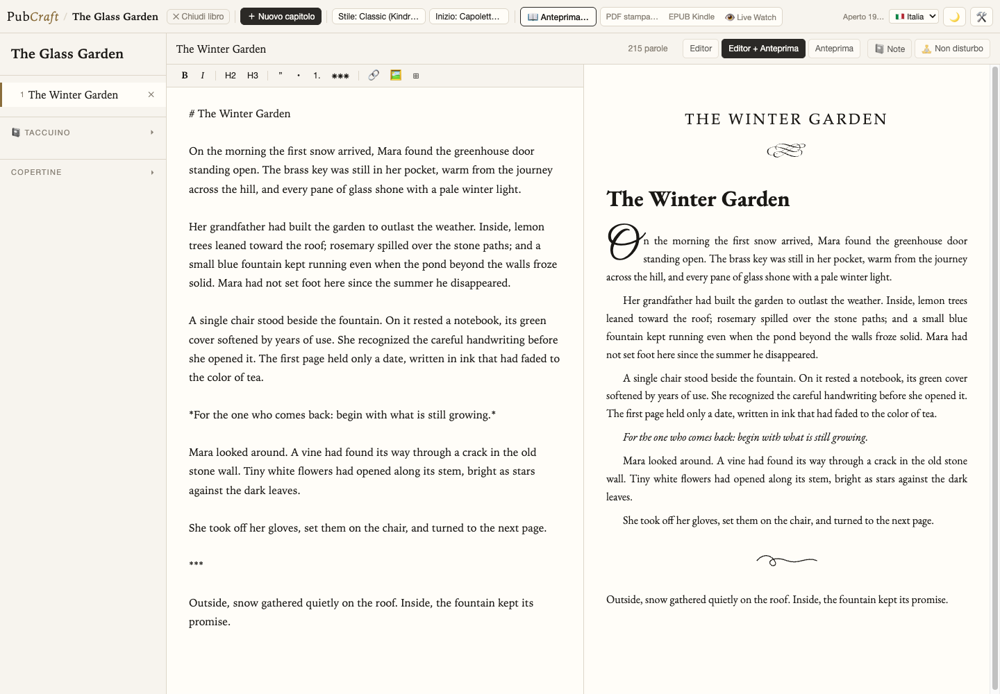

# PubCraft

**Write your book in Markdown. Keep your files local. Export EPUB and print interiors from one project.**

PubCraft is a free, open-source writing and publishing tool with a local browser-based editor, a C command-line compiler, manuscript import, EPUB export and print previews. Your work remains ordinary Markdown and `book.yaml`.

> **Alpha software:** keep backups and use copies of your manuscripts. Review every import/export. A successful build does not certify Amazon KDP, IngramSpark or other distributor compliance.

[](https://github.com/massigent/PubCraft/actions/workflows/ci.yml)
[](LICENSE)

**Latest pre-release: 1.0.0-alpha.7 — robustness update. Alpha software, not a stable release.**

### Pre-release downloads (1.0.0-alpha.7)

| Platform | Downloads |
| --- | --- |
| **macOS Universal (Intel + Apple Silicon)** | **[PubCraft.app ZIP](https://github.com/massigent/PubCraft/releases/download/v1.0.0-alpha.7/PubCraft-1.0.0-alpha.7-macos-universal.app.zip)** · [DMG app](https://github.com/massigent/PubCraft/releases/download/v1.0.0-alpha.7/PubCraft-1.0.0-alpha.7.dmg) · [PKG installer](https://github.com/massigent/PubCraft/releases/download/v1.0.0-alpha.7/PubCraft-1.0.0-alpha.7.pkg) · [Portable tools](https://github.com/massigent/PubCraft/releases/download/v1.0.0-alpha.7/PubCraft-1.0.0-alpha.7-macos.tar.gz) |
| Windows x64 | [Installer](https://github.com/massigent/PubCraft/releases/download/v1.0.0-alpha.7/PubCraft-Setup-1.0.0-alpha.7.exe) · [Portable ZIP](https://github.com/massigent/PubCraft/releases/download/v1.0.0-alpha.7/PubCraft-1.0.0-alpha.7-windows-x64.zip) |
| Linux x64 | [AppImage](https://github.com/massigent/PubCraft/releases/download/v1.0.0-alpha.7/PubCraft-1.0.0-alpha.7-x86_64.AppImage) · [Debian/Ubuntu](https://github.com/massigent/PubCraft/releases/download/v1.0.0-alpha.7/PubCraft-1.0.0-alpha.7-linux-amd64.deb) · [Portable archive](https://github.com/massigent/PubCraft/releases/download/v1.0.0-alpha.7/PubCraft-1.0.0-alpha.7-linux-x64.tar.gz) |

[Release notes and all files](https://github.com/massigent/PubCraft/releases/tag/v1.0.0-alpha.7) · [SHA-256 checksums](https://github.com/massigent/PubCraft/releases/download/v1.0.0-alpha.7/checksums-sha256.txt) · [Italiano](README.it.md) · [Report a problem](https://github.com/massigent/PubCraft/issues/new?template=bug_report.md)

Previous pre-release (fallback): [alpha.6 downloads and notes](https://github.com/massigent/PubCraft/releases/tag/v1.0.0-alpha.6).

**Mac installation:** extract the app ZIP and drag `PubCraft.app` into Applications, or use the DMG as usual. **macOS 13 Ventura or newer; no Rosetta required.** The launcher, CLI, GUI and PDF helper all include both CPU architectures. Quit the old app before replacing it.

> **macOS Security Notice (Gatekeeper / "Move to Trash"):**  
> PubCraft is a free open-source project with an ad-hoc code signature and is not enrolled in the paid Apple Developer Program ($99/year) or notarized by Apple. On first launch, macOS (especially Sonoma and Sequoia) may block the application with a false-alarm dialog: *"PubCraft is damaged and cannot be opened. You should move it to the Trash."*  
> **The application is intact and not damaged.** To clear the quarantine flag set by macOS on downloaded files and open it normally:
> 1. Drag `PubCraft.app` to your `/Applications` folder.
> 2. Open **Terminal** and run:
>    ```sh
>    xattr -cr /Applications/PubCraft.app
>    ```
> 3. Launch PubCraft normally with a double-click. *(Alternatively, if shown the standard Gatekeeper prompt, you can open System Settings → Privacy & Security and click "Open Anyway").*

The app is ad-hoc signed, not Developer ID signed/notarized; PKG and Windows installer are not publisher-signed. Use the official release and verify its checksums. GitHub's “Source code” downloads are not ready-to-run apps.



## What's new?

**Alpha.7 (robustness update):** fourteen real defects fixed across the CLI and the GUI, found in a full code-review pass — no new user-facing features. The CLI now writes a real `dcterms:modified` EPUB timestamp, bounds the KDP gutter recalculation (a book on a band boundary can no longer rebuild forever), keeps the `export-md` round-trip faithful (prose lines that merely start with `>`, `-`, a numbered item, `|`, a heading, a fence or an image are no longer re-interpreted as structure), accepts longer front-matter closing lines, accepts legitimate file names like `Part..1.md`, lists archives on Windows, validates the `bleed:` option like the `toc:` ones and hardens the binary-plist parser. The GUI fixes Windows process detection (single-instance reuse and preview cleanup work again), aligns chapter reordering to the open project, extends the CSRF middleware coverage, cleans up the recents filter and gives large builds a 5-minute budget. New C test suites and Go tests lock all of this in.

**Alpha.6 (stability update):** reinforced stability. A consistent section-type policy across the printed TOC, EPUB nav.xhtml and toc.ncx (per-format inclusion matrix, opt-in subheads, unknown types reported as warnings and paginated as normal chapters), CLI/GUI/`book.yaml` loading and validation parity for the `toc:` boolean options, PDF index-page cache keyed on the rendering environment so a changed setup cannot reuse stale page numbers, and a publication guard: a failed candidate PDF build keeps the previously published PDF untouched. The publication preview now warns when source files changed since the last render. The test hygiene pass consolidates 19 browser runners, and the AppImage tooling is pinned to appimagetool 1.9.1.

**Included from alpha.5:** corkboard drag-anywhere and non-destructive folder ↔ `book.yaml` synchronization.

**Alpha.4:** restored and expanded chapter reordering across views. Seamless up/down move arrows in the chapter list sidebar; previous/next move arrows and smooth drag-and-drop on the Corkboard (Lavagna) with zero accidental edit navigation and immediate persistence to `book.yaml`.

**Included from alpha.3:** Universal 2 Mac app and portable tools (Intel + Apple Silicon native, no Rosetta required, macOS 13+ minimum).

See the [alpha.7 notes](RELEASE_NOTES_1.0.0-alpha.7.md), [alpha.6 notes](RELEASE_NOTES_1.0.0-alpha.6.md), [alpha.5 notes](RELEASE_NOTES_1.0.0-alpha.5.md), [alpha.4 notes](RELEASE_NOTES_1.0.0-alpha.4.md), [alpha.3 notes](RELEASE_NOTES_1.0.0-alpha.3.md), [full alpha.2 changes](RELEASE_NOTES_1.0.0-alpha.2.md), [changelog](CHANGELOG.md), [alpha.7 validation record](docs/RELEASE_VALIDATION_1.0.0-alpha.7.md), the [alpha.6 validation record](docs/RELEASE_VALIDATION_1.0.0-alpha.6.md) and the [alpha.5 validation record](docs/RELEASE_VALIDATION_1.0.0-alpha.5.md).

## Why PubCraft?

- **Portable projects:** Markdown chapters, YAML metadata and local images, editable in PubCraft or another editor.
- **Local-first:** no PubCraft account or cloud backend. External AI clients connected through MCP have their own privacy practices.
- **Supported imports:** Vellum, Scrivener, DOCX, ODT, Markdown and PDF. Conversion is not an exact reproduction of every source feature; inspect the result.
- **Writing and publishing:** chapter organization, notes, manuscript preview, typography controls and explicitly generated EPUB/PDF publication previews.
- **Print:** HTML/PDF with trim and bleed controls. PDF generation requires an available supported renderer; pagination and appearance can vary. The produced PDF is checked page by page against the requested format (trim plus bleed, ±1 point): a renderer that ignores the page size (an unpaginated single-page snapshot) makes the build fail with an explicit message instead of publishing the file, and the page-number cache is left untouched.
- **Automatic table of contents:** generated in EPUB (hierarchical nav.xhtml + toc.ncx), in the HTML export, and in the printed index with page numbers measured on the real PDF. Configure subheadings and page numbers in `book.yaml`:

  ```yaml
  toc:
    subheads: true       # nested h3 subheadings in the TOC (default: false)
    pagenumbers: false   # page numbers in the printed TOC (default: true)
  ```

  Boolean options accept `true/false`, `yes/no`, `on/off` and `1/0`; an empty value, `~` or `null` keeps the default, and an invalid value is an explicit error in both the GUI and the CLI. TOC entries render inline emphasis in HTML, print and EPUB navigation (links stay plain text, so no nested links) and plain text in `toc.ncx`.

  Chapter `type:` values are section-type strings: `chapter`, `dedication`, `epigraph`, `copyright`, `colophon` (alias of `copyright`), `about-author`, `acknowledgments`, `prologue`, `epilogue`, `preface`. The same policy table drives all three TOCs: in print, dedication, epigraph and copyright/colophon are front matter and stay out of the index, while in the EPUB nav.xhtml and toc.ncx they appear. Subheadings are opt-in (`toc.subheads`, default false). An unknown type is reported as a warning and paginated as a normal chapter; the value in `book.yaml` is never rewritten.

  The publication preview shows page numbers only after a print build has cached the page map; until then its TOC stays without numbers so the render is not paid twice.

- **Free/open source:** MIT code; fonts/dependencies retain separate licenses.

## Getting started

Launch the app and choose **New Book** or open a project folder. A book contains `book.yaml`, `.md`/`.markdown` chapters and optional `cover/` and `images/` folders. Keep the original and a separate backup.

```sh
# GUI and live Watch
pubcraftgui ./my-book
pubcraftgui --watch ./my-book

# CLI
pubcraft init ./my-book "My Book"
pubcraft build ./my-book ./my-book.epub --kindle
pubcraft build-print ./my-book ./print-output --trim 6x9 --pages 200 --pdf

# Vellum conversion
pubcraft export-md "./My Book.vellum" "./My Book-markdown"
```

The browser UI is served by a local process, not a hosted service. Other manuscript formats can be imported through the GUI. The GUI binary also exposes stdio MCP through `pubcraftgui --mcp`.

## Build and test

Source minimum: `make`, a C compiler, Go 1.23+ and Python. Release builds use the pinned `.go-version`; Universal Mac packaging needs macOS SDK/signing tools and Python 3.12+.

```sh
make                       # native development tools, NOT a Mac release
make check                 # CLI, uncached Go race tests and release-guard tests
go -C src/pubcraftgui vet ./...
make pkg-macos             # Universal app + ZIP/DMG/PKG/portable tools
make verify-macos-release  # all formats, both slices, signatures and clean source
```

Read [AGENTS.md](AGENTS.md) and [docs/RELEASING.md](docs/RELEASING.md) before changing or publishing releases. Never reuse old executables or substitute native `make all` outputs for the Universal app. Native Intel/Apple Silicon, Linux and Windows checks live in [Release builds](.github/workflows/release-build.yml). See [tests/README.md](tests/README.md) for browser tests. Cross-compilation alone is not native execution or installation testing.

## Limits and feedback

Import conversion, typography and pagination depend on input, fonts, OS and renderer; EPUB readers may override typography. The WebKit helper produces a continuous snapshot, not certified multi-page KDP layout. Unsupported YAML update forms fail without changing the project. Linux ARM packages are not included.

[Issues](https://github.com/massigent/PubCraft/issues), documentation, translations and testing contributions are welcome; see [CONTRIBUTING.md](CONTRIBUTING.md). Include version, OS and reproduction steps. **Never attach private manuscripts or copyrighted covers. Review diagnostic reports before sharing: automatic redaction is not a guarantee.**

## License

Code: [MIT](LICENSE). See [font notices](fonts/README.md) and [third-party licenses](third-party-licenses/) for resources with separate licenses.
